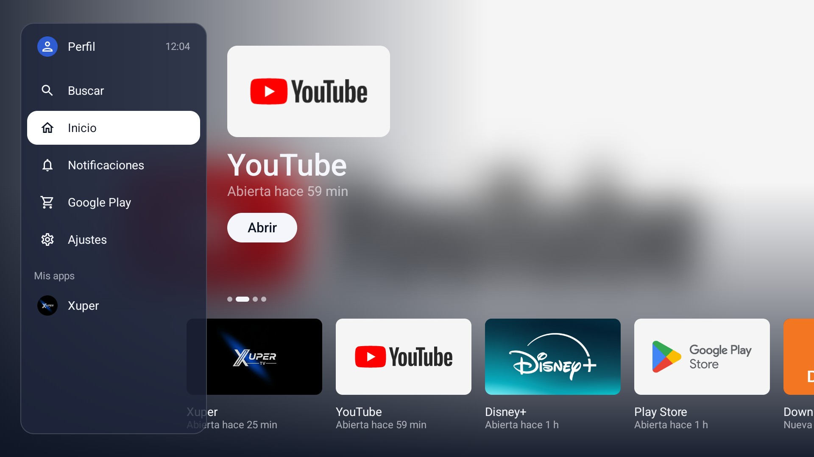

# 📺 ONN Launcher

### Un launcher limpio para Google TV, diseñado para usar desde el sofá.

Interfaz doméstica para el onn. 4K Streaming Box **TV Santiago**. Reemplaza las recomendaciones y anuncios por las aplicaciones que realmente se usan, con una navegación clara mediante control remoto.

[Interfaz](#interfaz) · [Funcionalidades](#funcionalidades) · [Tecnología](#tecnología) · [Uso](#uso) · [Compilación](#compilación) · [Documentación](#documentación)

La interfaz toma como referencia la distribución limpia de Apple TV: panel lateral translúcido, portada de la aplicación seleccionada y una fila de tarjetas. No utiliza recursos, marca ni tipografías de Apple.

## Interfaz

Al iniciar se muestra un panel lateral con el perfil, la hora y los accesos del sistema. Al pasar a las tarjetas, el panel se oculta para dar protagonismo a la portada.

La portada cambia con el foco y muestra el estado de uso de cada aplicación.

La navegación se realiza por completo con D-pad, OK, Atrás y Home. El foco se indica mediante escala y un anillo visible.

## Funcionalidades

- Aplicaciones recientes primero y el resto a continuación, sin duplicados.
- Portada con arte de la app, botón **Abrir** y carrusel automático de recientes cuando no hay interacción.
- Panel lateral con Perfil, Buscar, Inicio, Notificaciones, Google Play, Ajustes y aplicaciones fijadas.
- Mantener OK sobre una app para moverla, fijarla o quitarla de favoritos, u ocultarla.
- Accesos a las funciones nativas de Google TV: perfiles, notificaciones, Play Store y ajustes.
- El botón Home se intercepta mediante un servicio de accesibilidad sin desactivar Google TV.
- Respeta la opción del sistema para reducir animaciones.

## Tecnología

- Kotlin y Jetpack Compose for TV
- Android SDK 34, mínimo Android 12 (API 31)
- DataStore para preferencias locales
- UsageStats para ordenar aplicaciones recientes
- Sin permisos de Internet, cuentas propias ni recolección de datos

## Uso

En la TV, usa las flechas para navegar y OK para abrir una aplicación. Desde la primera tarjeta, pulsa izquierda —o Atrás desde el contenido— para volver a mostrar el panel lateral.

Para instalar, actualizar, reaplicar tras una actualización de Google TV, crear un respaldo o volver al launcher original, consulta el [runbook](docs/runbook.md).

## Compilación

El proyecto se compila con Gradle. En Windows, la ruta de este repositorio contiene caracteres no ASCII; consulta las [notas de compilación](docs/07-revision-construccion.md) para preparar una unidad virtual con `subst` antes de ejecutar las tareas de Gradle.

## Documentación

| Tema | Documento |
| --- | --- |
| Estado actual | [project-state.md](project-state.md) |
| Viabilidad | [docs/01-viabilidad.md](docs/01-viabilidad.md) |
| Requerimientos e historias | [docs/02-prd.md](docs/02-prd.md) · [docs/03-historias.md](docs/03-historias.md) |
| UX y tokens | [docs/ux/pantalla-inicio.md](docs/ux/pantalla-inicio.md) · [design/tokens.json](design/tokens.json) |
| Arquitectura | [docs/05-tdd.md](docs/05-tdd.md) · [docs/adr/](docs/adr/) |
| Prueba de concepto | [docs/06-poc-informe.md](docs/06-poc-informe.md) |
| Revisión y QA | [docs/07-revision-construccion.md](docs/07-revision-construccion.md) |
| Seguridad | [docs/08-seguridad.md](docs/08-seguridad.md) |

## Estado

Versión actual: **1.0.0**. La navegación, los accesos del sistema, el rendimiento y la intercepción real del botón Home se validan en el dispositivo objetivo.
