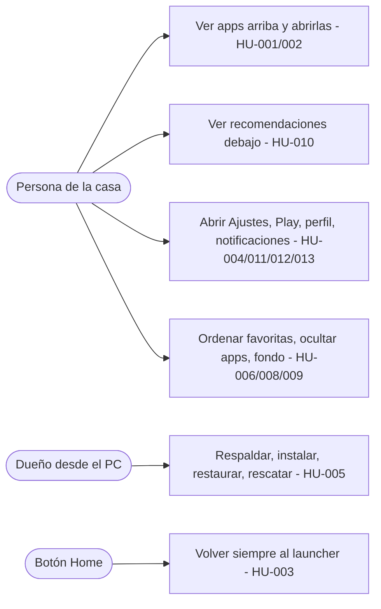
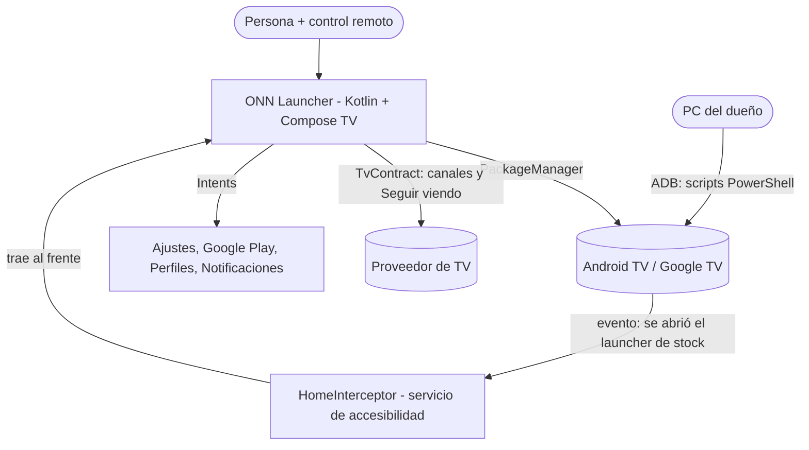
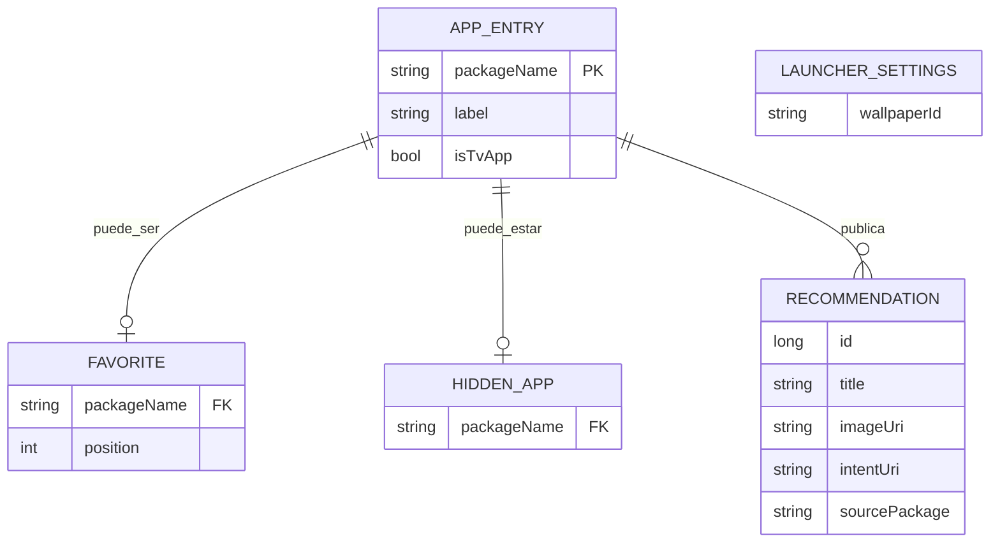

# TDD — ONN LAUNCHER

> Dueño: `architect` · **Versión:** 0.1 · **Fecha:** 2026-10-26 · **PRD:** [02-prd.md](02-prd.md) v0.2 · **ADR:** [001](adr/ADR-001-stack-kotlin-compose-tv.md), [002](adr/ADR-002-boton-home-hibrido.md)

## 1. Resumen
App Android TV en Kotlin + Jetpack Compose for TV que se registra como pantalla de inicio (categorías HOME y LEANBACK_LAUNCHER). Muestra arriba la fila de apps; debajo, las recomendaciones de las apps instaladas; en la barra superior, reloj, fecha y accesos de sistema (Ajustes, Google Play, perfil, notificaciones). El botón Home se toma con un servicio de accesibilidad (ADR-002). Se instala por ADB en la TV con scripts de respaldo, restauración, reaplicación y rescate. Sin cuentas ni servidor.

## 2. Actores y casos de uso

## 3. Contexto y contenedores (C4)

## 4. Componentes y capas
**Referencia:** Clean Architecture ligera, proporcional a una app pequeña: `ui` → `domain` (modelos y casos de uso) ← `data` / `system` (adaptadores Android).

| Componente | Responsabilidad | Capa |
|---|---|---|
| HomeActivity | Actividad única HOME + LEANBACK_LAUNCHER, singleTask; aloja la UI | ui |
| HomeScreen + HomeViewModel | Barra superior (reloj, perfil, notificaciones, Ajustes, Play) · fila de apps · filas de recomendaciones, en ese orden fijo | ui |
| GlassSurface | Superficie tipo vidrio: fondo pre-desenfocado + capa translúcida (versión ligera para el onn. Box) | ui |
| AppRepository | Apps lanzables, banner o ícono; se actualiza con PACKAGE_ADDED / REMOVED / CHANGED | data |
| PreferencesStore | Favoritas y orden, ocultas, fondo (Jetpack DataStore) | data |
| RecommendationsRepository | Lee canales, programas de vista previa y Seguir viendo vía TvContract **si el permiso está concedido**; si no, devuelve vacío y la sección no se muestra | data |
| SystemShortcuts | Intents a Ajustes, Google Play (com.android.vending), selector de perfiles y panel de notificaciones (intents exactos se confirman en la PoC) | system |
| HomeInterceptor | AccessibilityService acotado a TYPE_WINDOW_STATE_CHANGED del paquete del launcher de stock → lanza HomeActivity | system |
| scripts/ (PowerShell) | backup, install, apply-home, restore, rescue, reapply vía ADB | operación |

## 5. Modelo de datos (alto nivel)

APP_ENTRY y RECOMMENDATION son transitorios (se leen del sistema). Solo FAVORITE, HIDDEN_APP y LAUNCHER_SETTINGS se guardan en DataStore.

## 6. Contratos
No hay API de red. Contratos internos:

| Contrato | Entrada | Salida | Errores |
|---|---|---|---|
| AppRepository.apps(): Flow<List<AppEntry>> | — | apps lanzables sin ocultas | lista vacía, nunca excepción |
| RecommendationsRepository.rows(): Flow<List<RecRow>> | — | filas por app | sin permiso → lista vacía |
| SystemShortcuts.open(Shortcut) | Settings, Play, Profiles, Notifications | Result | intent no resuelto → aviso discreto |
| Scripts de operación | IP de la TV | log + carpeta de respaldo | ADB no conectado → mensaje claro, sin cambios |

## 7. Stack y decisiones
| Área | Elección | ADR |
|---|---|---|
| Lenguaje / UI | Kotlin, Jetpack Compose for TV (androidx.tv) | ADR-001 |
| Persistencia | Jetpack DataStore (Preferences) | no es decisión mayor |
| Botón Home | Accesibilidad por defecto; deshabilitar el stock solo si la PoC lo justifica | ADR-002 |
| Build | Gradle (Kotlin DSL), JDK 17, Android SDK; minSdk según la versión real de la TV (supuesto: 31) | — |
| Operación | ADB (platform-tools oficial de Google) + scripts PowerShell | — |
| Pruebas | JUnit + Robolectric (lógica y repositorios), Compose UI tests (foco y navegación) | — |

## 8. Seguridad — modelo de amenazas inicial (STRIDE)
| Amenaza | Dónde | Mitigación |
|---|---|---|
| Suplantación | Otra app se declara HOME | Nuestro launcher se fija por ADB; los scripts verifican paquete y firma |
| Manipulación | APK alterado | APK firmado con clave local fuera del repo (.gitignore); se instala solo desde el PC del dueño |
| Repudio | — | No aplica (sin cuentas ni transacciones) |
| Exposición de información | El servicio de accesibilidad ve eventos de ventanas | Configuración mínima: solo TYPE_WINDOW_STATE_CHANGED, filtro por paquete, sin leer contenido de pantalla ni registrar eventos. **Sin permiso de Internet**, salvo que las imágenes de recomendaciones lo exijan (pregunta abierta) |
| Denegación de servicio | Launcher en bucle de cierres | Google TV no se desinstala; script rescue restaura con un comando |
| Elevación de privilegios | Accesibilidad + READ_EPG_DATA concedidos por ADB | Solo los permisos que piden las historias, documentados y revocados por restore. Tras instalar, se recomienda apagar la depuración ADB de la TV |

Checklist completo con cybersecurity-engineer antes del release.

## 9. Requisitos no funcionales y estrategia
| Requisito | Estrategia |
|---|---|
| Home → visible < 1,5 s | singleTask (la actividad queda viva); Baseline Profiles; íconos asíncronos con caché en memoria |
| Navegación fluida (60 fps) | Filas perezosas; sin desenfoque en vivo: fondo pre-desenfocado + capas translúcidas (lo valida Performance) |
| Interfaz a 3 m | Tokens de UX: tamaño mínimo de texto; foco con escala y borde de alto contraste |
| Reversibilidad | Ningún uninstall de sistema; restore y rescue probados en la TV antes de dejarlo fijo |
| Nada encima de la fila de apps | Orden fijo de secciones en HomeScreen; un test de UI lo verifica |

## 10. Prueba de concepto (condición 5) y preguntas abiertas
La PoC es una app mínima desechable más comandos ADB en la TV, **después del respaldo**. Debe responder:
1. Versión de Android/Google TV y paquete real del launcher de stock.
2. ¿Se puede conceder READ_EPG_DATA por ADB? ¿Qué canales, programas y Seguir viendo de otras apps se pueden leer?
3. Intents que abren el selector de perfiles y el panel de notificaciones, con el launcher de stock activo y deshabilitado.
4. Servicio de accesibilidad: ¿captura Home? ¿cuánto se nota el parpadeo?
5. ¿Las imágenes de recomendaciones son URIs locales o URLs? (decide si hace falta permiso de Internet)

**Prerrequisitos:** activar la depuración en la TV (lo haces tú en la TV); instalar en el PC, con tu permiso, platform-tools (ADB), JDK 17 y Android SDK/Gradle.
