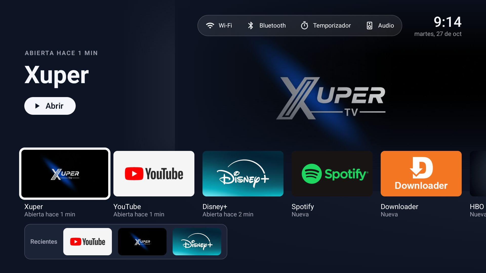
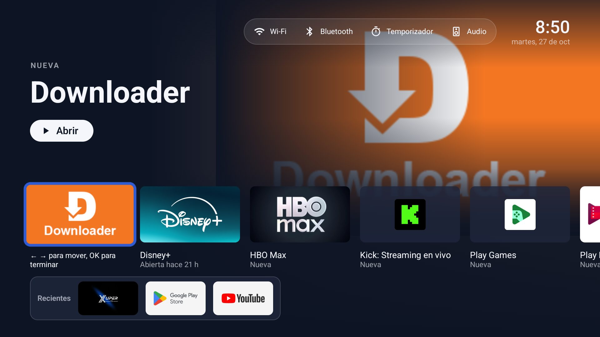

# Especificación UX — Pantalla de inicio · v0.2 (borrador)

**Rol:** ux-ui-designer · **Fecha:** 2026-10-26 · **Ruta:** FEATURE · **Tokens:** design/tokens.json (base 960x540 dp)
**Cambio frente a v0.1:** el usuario pide la **distribución de la app Apple TV** (referencia: Apple Newsroom, dic. 2023) manteniendo las tarjetas. Solo se toma la distribución: sin íconos, marca ni tipografía de Apple.

## Distribución
```
┌───────────────────────────────────────────────────────────────┐
│┌─────────┐                                                    │
││Perfil hh:mm│     PORTADA (app con foco, arte en grande)       │
││ Buscar   │      Título de la app                              │
││▶Inicio   │      Subtítulo (ej. "Abierta hace 2 h")            │
││ Notific. │      [ Abrir ]                     ● ○ ○ ○          │
││ G. Play  │                                                    │
││ Ajustes  │ ┌────┐ ┌────┐ ┌────┐ ┌────┐ ┌────┐                 │
││ Mis apps │ │card│ │card│ │card│ │card│ │card│  →              │
││ • YouTube│  Título Título ...                                 │
││ • Disney+│  sub    sub                                        │
│└─────────┘                                                    │
└───────────────────────────────────────────────────────────────┘
```

### 1. Panel lateral de vidrio (HU-015)
- Arriba: avatar + nombre del perfil (abre el selector de perfiles, HU-012) y la hora.
- Navegación: **Buscar** (HU-016), **Inicio** (seleccionado), **Notificaciones** (HU-013), **Google Play** (HU-011), **Ajustes** (HU-004).
- Sección **Mis apps**: las favoritas en su orden (HU-006), con su ícono pequeño; OK abre la app.
- **Se ve al abrir** el launcher. Al pulsar → o ↓ hacia el contenido, el panel **se oculta** (deslizamiento `base`) y la portada ocupa toda la pantalla. Con ← desde la primera tarjeta, o con Atrás, el panel vuelve.

### 2. Portada (HU-014)
- Muestra **la app con foco** en las tarjetas: fondo a pantalla completa con el banner de la app **ampliado y desenfocado** (el banner es de baja resolución; el desenfoque lo disimula), y encima el banner nítido, el nombre (2xl) y un subtítulo.
- Subtítulo: cuándo se usó por última vez ("Abierta hace 2 h", "Ayer") o "Nueva" si no hay uso.
- Botón **Abrir** (el único botón primario de la vista).
- **Carrusel**: si nadie navega por 8 s, la portada rota entre las Recientes (máx. 5). Puntos indicadores debajo. Se detiene al navegar.
- Velo oscuro en la mitad inferior para que el texto y las tarjetas sean legibles (contraste AA).

### 3. Fila de tarjetas (HU-001, HU-010)
- Tarjetas 16:9 (`tile-app`) con **título y subtítulo debajo** (como Apple TV), primero las **Recientes** y luego el resto de apps (sin duplicados).
- Foco: escala + anillo blanco; la portada cambia a la app con foco (transición `slow`).
- Mantener OK: menú Mover / Fijar en Mis apps / Ocultar (HU-006, HU-008).

## Navegación con control
| Desde | Tecla | Va a |
|---|---|---|
| Panel | ↑/↓ | ítems del panel |
| Panel | → | primera tarjeta (el panel se oculta) |
| Tarjetas | ←/→ | tarjeta vecina; ← en la primera → vuelve el panel |
| Tarjetas | ↑ | botón Abrir de la portada |
| Cualquiera | Atrás | si el panel está oculto, lo muestra; si no, nada |

Foco inicial al abrir: **Inicio** en el panel (como Apple TV).

## Estados
| Estado | Qué se ve |
|---|---|
| Éxito | Distribución completa (mockup v2) |
| Carga | Portada con el color de fondo de la app y fundido al cargar el arte; tarjetas con su color |
| Vacío | Sin Recientes: la portada muestra la primera app; sin apps de terceros: portada "Instala apps desde Google Play" con botón |
| Error | Aviso de vidrio abajo, 3 s: "No se pudo abrir X. Intenta de nuevo." |

## Tamaños
720p / 1080p / 4K: misma composición en dp; el panel mide 220 dp de ancho; ~5 tarjetas visibles con panel oculto.

## Accesibilidad
- Texto sobre portada: velo oscuro garantiza ≥ 4.5:1; el foco nunca depende solo del color.
- TalkBack: panel como lista de navegación; portada anuncia "YouTube, abierta hace 2 h, botón Abrir".
- Carrusel: se detiene con foco y respeta "Quitar animaciones" (sin rotación automática).

## Notas para construcción
- Desenfoque de la portada: bitmap reducido y ampliado (o RenderEffect en API 31+), calculado una vez por app y en caché (Performance).
- Buscar (HU-016) depende de que el intent de búsqueda de Google TV abra desde nuestra app: se verifica al construir; si no abre, el ítem se oculta.

---
## v0.3 — Barra superior: reloj y accesos rápidos (HU-017) · 2026-10-27
Pedido del usuario: arriba, un reloj y accesos rápidos a Wi-Fi, Bluetooth, temporizador y salida de audio (como el panel de Google TV).

- **Ubicación:** arriba a la derecha del área de contenido, siempre visible (también con el panel oculto).
- **Contenido (izquierda → derecha):** cápsula de vidrio con 4 accesos tipo píldora (icono + texto corto) y, a la derecha, el **reloj** (hora `xl`, fecha `xs` debajo).
- **Accesos** (verificados en la TV):
  | Acceso | Texto | Acción |
  |---|---|---|
  | Wi-Fi | "Wi-Fi" / "Sin red" | Abre Ajustes → Red (`NetworkActivity`) |
  | Bluetooth | "Bluetooth" | Abre Agregar accesorio (`AddAccessoryActivity`); si no abre, Ajustes. El interruptor de Bluetooth de Google TV no es accesible a otras apps |
  | Temporizador | "Temporizador" / "Quedan 25 min" | Menú propio: Desactivado, 15, 30, 60, 90, 120 min. Al terminar, el servicio de accesibilidad pone la TV en reposo |
  | Salida de audio | "Audio" | Abre Ajustes → Pantalla y sonido (`DisplaySoundActivity`); el selector rápido de Google TV no es accesible |
- **Navegación:** ↑ desde Abrir llega a la barra; ←/→ entre accesos; ↓ vuelve a Abrir.
- **Estados:** temporizador activo resalta la píldora y muestra los minutos restantes; error al abrir → aviso de 3 s.

## v0.4 — Orden propio, ventana de Recientes y portada "Continuar" (HU-018..020) · 2026-10-27
Pedido del usuario: apps en el orden que él quiera, debajo una ventana pequeña con máximo 3 recientes que no se reordenan, quitar el banner de recientes de arriba y usar una portada más premium tipo Apple TV, con el contenido real de las apps si se puede.

- **Distribución (de arriba abajo):** barra superior (sin cambios) · portada · fila de Apps · ventana de Recientes.
- **Portada:** fondo a pantalla completa. Imagen nítida (banner de la app o portada del contenido) en el 64 % derecho y 70 % superior, fundida hacia la izquierda y hacia abajo con el fondo; luz ambiente con el color promedio de la imagen. Texto a la izquierda (máx. 380 dp): antetítulo en mayúsculas (`xs`, espaciado 1,5) — "ABIERTA HACE 2 H" o "CONTINUAR EN NETFLIX" —, título (`x3l` para apps, `x2l` y hasta 2 líneas para contenido), subtítulo (`md`) y píldora blanca **▶ Abrir** / **▶ Continuar**. Sin carrusel ni puntos.
- **Qué muestra:** la última app enfocada en la fila o en Recientes; al volver el panel, lo último reproducido o, si no hay, la primera app del orden.
- **Fila de Apps:** tarjetas 160×90 con título y "Abierta hace…", en el orden del usuario. En modo Mover la tarjeta lleva borde azul y el texto "← → para mover, OK para terminar".
- **Ventana de Recientes:** cápsula de vidrio (`surfaceStrong`, borde `border`, radio `md`) con la etiqueta "Recientes" y 3 miniaturas de 96×54. Va debajo de la fila, alineada con el contenido.
- **Navegación:** ↓ desde la fila va a Recientes; ← en la primera de cada fila abre el panel; Atrás con el panel visible lo cierra y lleva a la primera app.



